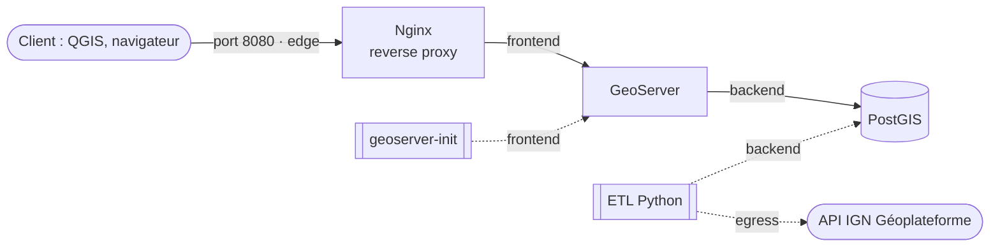

# Infrastructure SIG conteneurisée et pipeline ETL

Une plateforme SIG complète qui tient dans un `docker compose up` :

- **PostGIS** stocke les données, **GeoServer** les publie en WMS/WFS, **Nginx** est le seul point d'entrée.
- Un **pipeline ETL Python** récupère les communes de l'IGN (API Géoplateforme), les nettoie et les charge dans PostGIS.
- **GitHub Actions** démarre la stack à chaque push, exécute l'ETL et vérifie toute la chaîne.

## Architecture



Les traits pleins sont les services permanents, les pointillés les tâches ponctuelles.

### Cloisonnement réseau

| Réseau     | Accès extérieur | Services                         | Rôle                                   |
| ---------- | --------------- | -------------------------------- | -------------------------------------- |
| `edge`     | oui             | nginx                            | Porte le seul port publié sur l'hôte   |
| `frontend` | non (`internal`) | nginx, geoserver, geoserver-init | Trafic du proxy vers GeoServer         |
| `backend`  | non (`internal`) | geoserver, postgis, etl          | Accès à la base de données             |
| `egress`   | oui             | etl                              | Sortie Internet de l'ETL vers l'API IGN |

Ce découpage donne les garanties suivantes :

- **PostGIS n'est joignable ni depuis l'hôte ni depuis Nginx.** Il n'a aucun port publié et n'appartient qu'au réseau `backend`. Un attaquant qui compromet le proxy n'atteint pas la base.
- **GeoServer n'a pas d'accès à Internet.** Ses deux réseaux sont internes : s'il est compromis, il ne peut ni télécharger de charge utile ni exfiltrer de données directement.
- **Seul Nginx est exposé**, par défaut sur `127.0.0.1:8080`.
- **L'ETL est le seul conteneur qui sort sur Internet**, et il n'est sur aucun réseau partagé avec Nginx.

### Durcissement

| Composant | Mesures |
| --------- | ------- |
| Nginx     | Image non privilégiée, système de fichiers en lecture seule, toutes les capacités Linux retirées. Liste blanche des services OGC (`ows`, `wms`, `wfs`), le reste répond 403, dont l'interface d'administration et l'API REST de GeoServer. Lecture seule (GET/HEAD). Limitation de débit et de connexions par IP, délais courts, taille de requête bornée, version masquée, en-têtes de sécurité. |
| PostGIS   | Trois rôles distincts : `sig_admin` (administration), `etl_writer` (écriture limitée aux tables de l'ETL), `geoserver_ro` (lecture seule). Droits par défaut de `PUBLIC` retirés sur la base. Contraintes de validité sur les géométries. |
| GeoServer | Processus non root, sans données de démonstration, mot de passe administrateur imposé au démarrage. |
| ETL       | Utilisateur non root, lecture seule, sans capacité Linux. |
| Tous      | `no-new-privileges`, journaux bornés, images épinglées, aucun mot de passe par défaut : la stack refuse de démarrer si un secret manque. |

L'administration de GeoServer se fait par son API REST depuis le réseau `frontend`, comme le fait la tâche `geoserver-init`. L'interface web n'est volontairement pas exposée.

## Démarrage

Prérequis : Docker avec le plugin Compose v2.

```bash
cp .env.example .env          # puis renseigner les mots de passe (openssl rand -hex 24)
docker compose up -d --wait   # PostGIS, GeoServer, Nginx
docker compose run --rm etl             # charge les communes dans PostGIS
docker compose run --rm geoserver-init  # publie la couche sig:communes
```

Vérification :

```bash
curl "http://localhost:8080/geoserver/sig/ows?service=WFS&version=2.0.0&request=GetFeature&typeNames=sig:communes&count=1&outputFormat=application/json"
```

Dans QGIS, ajouter une connexion WFS ou WMS vers `http://localhost:8080/geoserver/sig/ows`.

Accès à la base pour l'administration : `docker compose exec postgis psql -U sig_admin -d sig`.

Arrêt : `docker compose down` (ajouter `-v` pour supprimer aussi les données).

## Pipeline ETL

Source : couche `ADMINEXPRESS-COG.LATEST:commune` du WFS de la Géoplateforme IGN, filtrée par département.

| Étape         | Module         | Ce qui est fait |
| ------------- | -------------- | --------------- |
| Extraction    | `extract.py`   | Requêtes WFS paginées et triées. Nouvelle tentative avec attente croissante sur erreur réseau, erreur serveur ou réponse non JSON. Échec si le nombre d'entités reçues diffère du nombre annoncé. |
| Nettoyage     | `transform.py` | Validation du code INSEE et du nom, normalisation des textes, valeurs numériques aberrantes mises à `NULL`, conversion en MultiPolygon 2D, contrôle des anneaux et de l'emprise (détecte une inversion longitude/latitude), dédoublonnage. Les entités inexploitables sont rejetées avec leur motif. |
| Chargement    | `load.py`      | Une transaction par département : reprojection en Lambert-93, réparation des géométries, insertion ou mise à jour, suppression des communes disparues de la source, ligne dans le journal `ref.etl_runs`. |
| Vérification  | `verify.py`    | Nombre de lignes attendu, géométries valides, SRID 2154, emprise France, surfaces positives, noms renseignés. |

Le pipeline est idempotent : le relancer ne crée pas de doublon. Il ne charge rien si aucune commune n'est exploitable ou si le taux de rejet dépasse 5 % (`ETL_MAX_REJECT_RATIO`), et se termine avec un code de sortie non nul en cas d'échec.

```bash
docker compose run --rm etl run --departements 91,94   # autres départements
docker compose run --rm etl verify                     # contrôles seuls
```

Le périmètre est la France métropolitaine, les données étant stockées en Lambert-93 (EPSG:2154).

### Développement local

```bash
cd etl
python -m venv .venv && source .venv/bin/activate   # Windows : .venv\Scripts\activate
pip install -e ".[dev]"
pytest                             # tests unitaires, sans base ni réseau
ruff check . && ruff format --check .
python -m sig_etl run --dry-run    # extraction et nettoyage réels, sans chargement
```

Derrière un proxy d'entreprise qui inspecte le trafic HTTPS, indiquer son autorité de certification avec la variable `REQUESTS_CA_BUNDLE`.

## Intégration continue

Le workflow [`ci.yml`](.github/workflows/ci.yml) s'exécute à chaque push et pull request, ainsi que chaque lundi pour détecter une évolution de l'API IGN.

1. **ETL** : lint (`ruff`) et tests unitaires (`pytest`).
2. **Stack Docker** :
   - validation du fichier Compose et construction de l'image ETL ;
   - démarrage de PostGIS, GeoServer et Nginx avec des secrets générés pour l'occasion ;
   - exécution de l'ETL sur l'API IGN réelle, deux fois pour prouver l'idempotence, puis contrôles de qualité ;
   - publication de la couche dans GeoServer ;
   - [tests de bout en bout](tests/stack/test_stack.py) : cloisonnement des réseaux, ports publiés, refus de l'administration et des méthodes d'écriture, en-têtes de sécurité, puis lecture des communes en WFS et rendu WMS à travers Nginx.

## Structure du dépôt

```text
docker-compose.yml        Services, réseaux et volumes
.env.example              Variables à copier dans .env
nginx/                    Configuration du reverse proxy
postgis/init/             Rôles et schéma, appliqués à la création de la base
geoserver/publish.sh      Publication de la couche par l'API REST
etl/                      Pipeline Python (code, tests, Dockerfile)
tests/stack/              Tests de bout en bout de la stack
.github/workflows/ci.yml  Intégration continue
```

## Limites et pistes d'évolution

- **Pas de TLS.** Nginx écoute en HTTP sur l'hôte local. Avant toute exposition, terminer le TLS sur Nginx ou sur un répartiteur de charge placé devant.
- **Secrets dans `.env`.** Convient à un poste de développement ; en production, utiliser les secrets Docker ou un gestionnaire de secrets.
- **Pas de sauvegarde** de la base ni du répertoire de données GeoServer.
- **Mot de passe administrateur GeoServer** réappliqué à chaque démarrage par la variable d'environnement, ce qui écrase une modification faite dans GeoServer.
- **Un seul hôte.** Pas de haute disponibilité ni d'orchestration.
